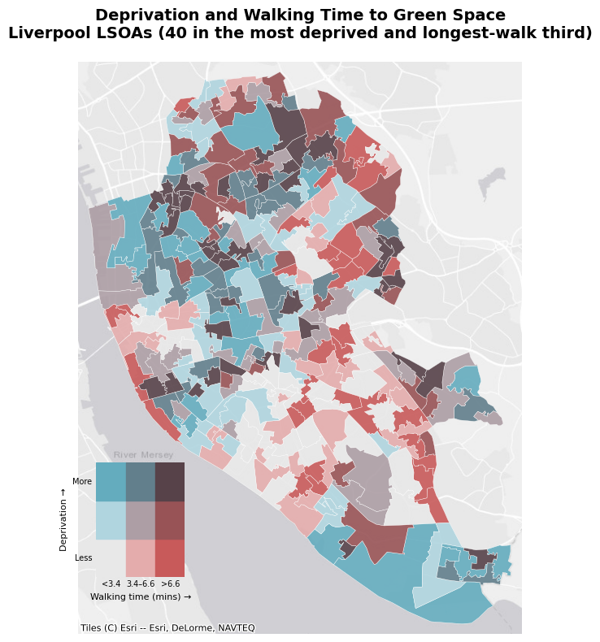

# Walking Access to Green Space and Deprivation in Liverpool

Does where you live in Liverpool affect how far you have to walk to reach a park? This project measures the walking time from every neighbourhood (LSOA) in Liverpool to its nearest public green space, compares it with the Index of Multiple Deprivation 2019, and presents the results in static maps and an interactive Panel dashboard.

**[Open the interactive dashboard](https://selomcaleb.github.io/liverpool-green-space-access/dashboard.html)**



## Approach

1. **Neighbourhoods and deprivation.** Liverpool's 298 LSOAs (2011 boundaries) with their IMD 2019 rank and decile.
2. **Green space.** Parks, gardens, nature reserves, recreation grounds, village greens and woods from OpenStreetMap via `osmnx`. Private gardens and spaces under 1,000 m² are removed.
3. **Walking network.** The OpenStreetMap pedestrian network for Liverpool.
4. **Walking time.** Each LSOA and each green space is snapped to its nearest network node. A multi-source Dijkstra search then finds the shortest walking distance from every LSOA to its nearest green space, converted to minutes at 80 m per minute.
5. **Visualisation.** Four static maps (deprivation, green space, walking time, and a bivariate map combining deprivation with walking time) and a Panel dashboard with a layer selector, a deprivation filter, a walking-time slider, summary indicators and linked charts.

## Findings

* 40 of Liverpool's 298 LSOAs fall in both the most deprived third and the longest-walk third (over 6.6 minutes to the nearest green space). These are the darkest areas on the bivariate map, and most are in the north of the city, with smaller pockets in the east and around Speke.
* Most of the city is within a 5-minute walk of some green space, so the inequality shows up in specific clusters rather than as a city-wide pattern.
* [Optional: add the mean walking time for the most and least deprived LSOAs, from the dashboard's deprivation filter.]

## Repository contents

| Path | Contents |
| --- | --- |
| `Assignment2.ipynb` | The full analysis: data loading, static maps, bivariate map and dashboard |
| `dashboard.html` | The exported, self-contained dashboard (also served through GitHub Pages) |
| `images/` | The static maps as PNGs |
| `environment.yml` | Conda environment used to run the notebook |
| `data/` | Not included in the repository. See *Data* below |

## Running it

```bash
conda env create -f environment.yml
conda activate geovis
jupyter lab Assignment2.ipynb
```

Then **Kernel → Restart Kernel and Run All Cells**. The notebook downloads OpenStreetMap data, so it needs an internet connection.

## Data

| Dataset | Source | Notes |
| --- | --- | --- |
| IMD 2019 with 2011 LSOA boundaries | [Geographic Data Service](https://data.geods.ac.uk/dataset/index-of-multiple-deprivation-imd) | Download the shapefile and place the `IMD_2019.*` files in `data/`. Not included here because of its size |
| Green space and walking network | OpenStreetMap, retrieved with `osmnx` | Downloaded automatically when the notebook runs |

## Revisions

This project was submitted as coursework for the Advanced Geovisualisation module at the University of Liverpool. The feedback was positive about the narrative and the analytical approach, and raised three design points. This version addresses them:

* **LSOA geometries.** The first version used super-generalised boundaries. This version uses the full IMD 2019 boundary file, which follows streets and the coastline. Because IMD 2019 is published on 2011 LSOA codes, using its own boundaries also fixed 16 LSOAs that had no IMD value when it was joined to 2021 boundaries.
* **Bivariate map.** IMD and walking time are now combined in a 3 × 3 bivariate map, both as a static map and as a layer in the dashboard.
* **Dashboard layout.** Panels now share fixed widths so the map and the summary column line up.

Other fixes made while revising:

* The IMD colour scales on the first two maps were inverted (IMD rank 1 is the most deprived). All maps and dashboard layers now show the most deprived areas in red.
* OpenStreetMap tags many private back gardens as `leisure=garden`. These are now excluded so they aren't counted as public green space.
* The walking-time map and dashboard use a colour-blind-safe yellow-to-red scale.
* The exported dashboard is down from 187 MB to about 55 MB, by moving the green-space toggle into the map and using 5-minute slider steps.
* File paths are relative, so the notebook runs from the repository folder.

## Limitations

* Walking time is measured between single representative points: one inside each LSOA and one inside each green space. Large parks with many entrances will show longer walks than people really make.
* The walking network stops at the city boundary, so green spaces just outside Liverpool are ignored.
* OpenStreetMap coverage and tagging vary, so some public spaces may be missing or mis-tagged.
* Distance is only one part of access. Quality, safety and size of green space are not measured.

## Licences

Basemap tiles: © Esri.

IMD 2019: MHCLG, Open Government Licence. LSOA boundaries: © Crown copyright and database right. OpenStreetMap data: © OpenStreetMap contributors, ODbL.
